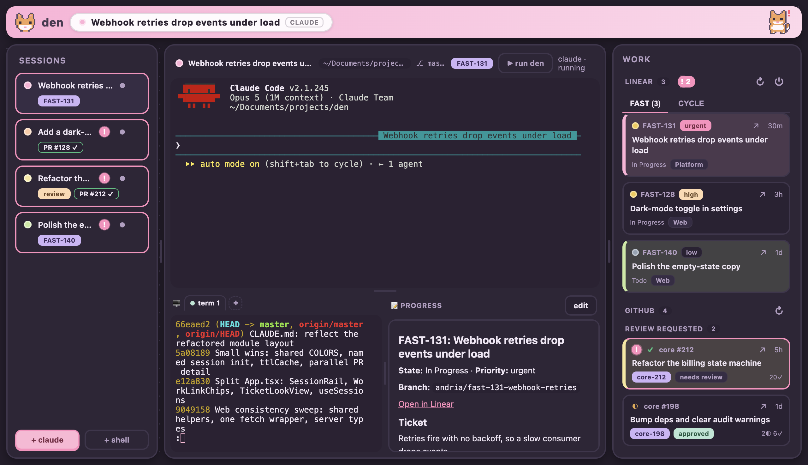
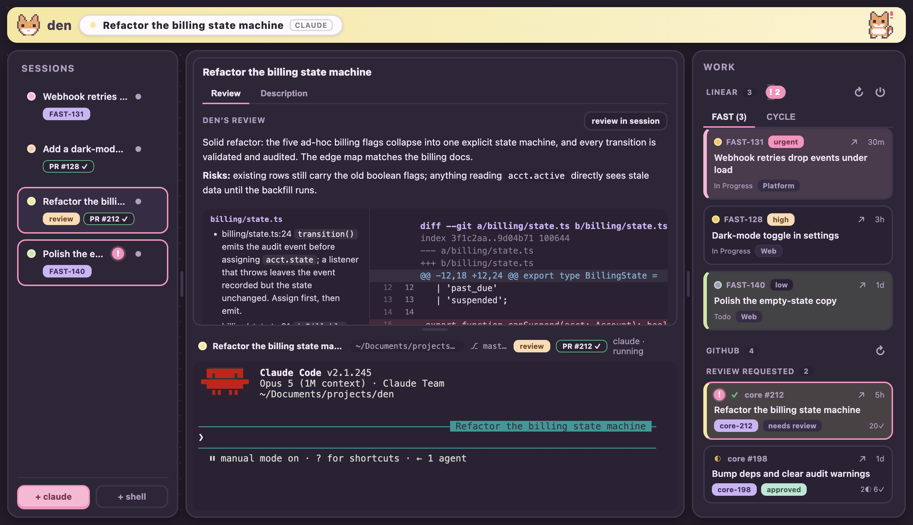
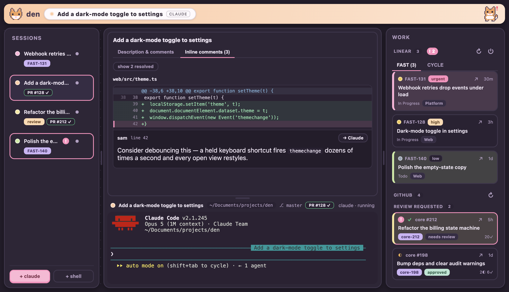
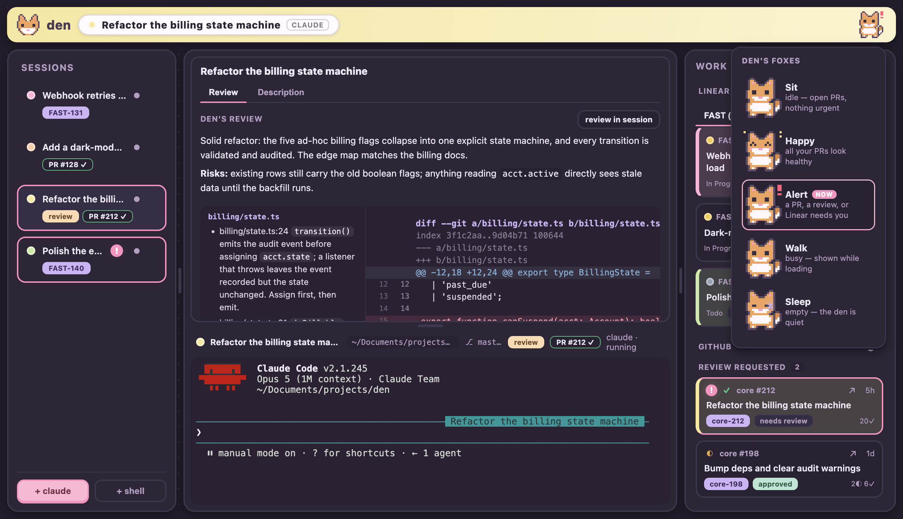
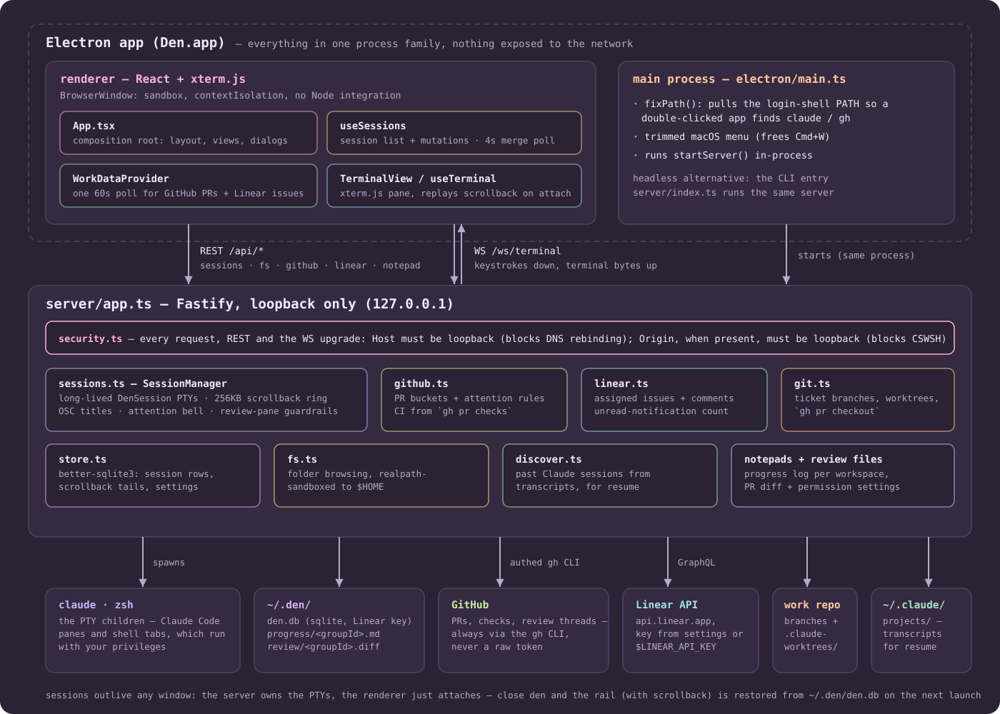

# den

A pixel-art desktop app for running many Claude Code sessions as one workflow.
Each session is tied to a Linear ticket or a GitHub PR, and a manager session,
Fox, runs the day across all of them: it plans the morning with you, passes
your answers to the sessions, and tucks them in at night so long chats stop
burning tokens.



den is an Electron and React app. Sessions sit in a rail on the left. The
middle is a Claude workspace: a Claude Code pane, shell tabs, and a handover
notepad the session keeps for you and for whichever session picks the work up
next. The right is a work panel with your Linear tickets and GitHub PRs.
Sessions belong to den's server, so they outlive the window and survive a
restart.

## A day in den

1. **Start.** Press **start** in the top bar. den gathers what changed: every
   session's handover, your PRs with their CI and review state, your Linear
   tickets and inbox, and the GitHub threads you're in. Fox, the manager
   session, reads it and writes a **Today** list grouped into decisions you
   owe, reviews and replies people are waiting on, work to continue, and
   things worth knowing.
2. **Work through it.** Each item links to its session. Answer a question in
   Fox's pane and Fox passes your answer on, signed with the time. A session
   on the list shows **next** in its header, which takes you to the next item.
3. **Clock out.** Press **clock out** at the end of the day. den lists every
   running session as safe to end, or keeps it up with the reason (still
   working, a merge in progress, staged changes, CI running). For the ones you
   tick, each handover is brought up to date and the chat ends. The next
   morning they come back on fresh conversations that pick up from their
   handovers. Pin a session to keep it running through the night instead.

## The crew

Fox's helpers are forest animals, each on the model that suits its job.

| Who | Job | Model |
| --- | --- | --- |
| Fox | Plans the day, keeps the Today list, passes your answers to sessions | Opus |
| Kits | The sessions that write the code, one per ticket. Each wears a scarf in its session's colour | Your default |
| Owl | Reviews colleagues' PRs and a kit's own PR before you look, and advises on hard problems | Opus, or Fable when the week has room |
| Badger | Runs the tests and checks a change in the browser | Sonnet |
| Hare | Looks for slow queries, wasted renders, and heavy loops | Sonnet |
| Wolf | Reviews a change for auth gaps, leaked secrets, and injection | Opus |
| Raccoon | Reads failing CI logs and says whether a failure is a flake or real | Haiku |
| Tanuki | Sorts your Linear inbox and GitHub notifications | Sonnet |
| Hedgehog | Brings each handover up to date at clock out | The session's own |
| Field mouse | Tracks the week's token use against an even pace | None, it's den's code |

Kits call Badger, Hare, Wolf, Raccoon, and Owl themselves, as Claude Code
subagents, before they call a piece of work done.

## Other highlights

- **Sessions tied to your work.** Open a Linear ticket or a GitHub PR and den
  starts a Claude session on the right branch, in a git worktree if you like,
  with the ticket in its handover. Stacked branches show how far they are
  behind their parent, and den tells a session when its parent moves.
- **PR review in the app.** For a colleague's PR, a **Guide** tab reads the
  change in the order it was written, with an explanation above each group of
  files, and a **Review** tab shows each file's comments beside its diff. The
  review session can run the tests but is told, with a permission backstop,
  never to commit, push, or post.

  

- **Your own PRs.** The description, reviews, and inline comments sit beside
  the session, each with a button that hands it to Claude.

  

- **Token pace.** The top bar shows how much of the week's plan you've used
  against an even pace, and which chats send the most context with each turn.
  A workspace's **fresh** button starts it from its handover instead of
  reloading the whole chat.
- **Built for a small screen.** The work panel folds to a strip of counts
  (Cmd+\\), and the GitHub list splits into **Review requested** and **My
  open PRs**.
- **A fox that reads the room.** The status fox goes alert when a PR needs
  you, Linear has unread notifications, or an urgent ticket hasn't started.

  

## Run

You need the `claude` and `gh` CLIs on your `PATH`. Linear is optional: paste
a personal API key into the work panel.

### Run the desktop app

```bash
npm install
npm run app      # builds and launches; the first run also builds native/ for Electron
```

The Node server runs inside Electron's main process on an ephemeral port.
den keeps its data in `~/.den`.

### Build a double-click app

```bash
npm run pack     # unsigned Den.app in release/mac-arm64/, for local use
```

Copy `Den.app` into `/Applications`. If you ran den v2 under its working name,
Burrow, den moves Burrow's data into `~/.den` the first time it starts and
keeps the earlier den's data in `~/.den-v1`. Quit Burrow before you open den.

### Run it in the browser

```bash
npm run dev      # server on :4321, web on :5173; open :5173
```

> **Native modules.** `node_modules` stays built for Node, and the app uses
> its own Electron build of `better-sqlite3` in `native/`, which `npm run app`
> and `npm run pack` make for you. If a stale checkout mixes them up, the
> startup error names the command to run.

## How it works



(The same map lives inside the app. Click the top bar's status fox.)

- A Node and TypeScript backend runs inside Electron's main process, and can
  also run standalone from a CLI. Terminals stream over a WebSocket; everything
  else is REST.
- `server/` holds long-lived PTYs (`sessions.ts`), a `better-sqlite3` store,
  and the `gh`, Linear, and `git` integrations. `web/` is React and xterm.js.
- The server is a **loopback-only control plane**: it rejects cross-origin /
  DNS-rebound requests, sandboxes file browsing to `$HOME`, validates branch and
  path inputs, and never stores or logs your API keys in the repo (the Linear
  key lives only in `~/.den/den.db`, which is gitignored).

## Security

**den runs commands on your machine as you.** It spawns real shells and Claude
Code, `git`, and `gh` processes with your privileges. That's the whole point, but
it also means the local server is as trusted as your terminal. Treat it that way:

- **Keep it on loopback.** The server binds `127.0.0.1` and, in the app, an
  ephemeral port. An `onRequest` guard (`server/security.ts`) rejects any request
  whose `Host` isn't loopback (blocks DNS-rebinding) or whose `Origin`, when
  present, isn't loopback (blocks cross-site WebSocket/fetch hijacking), for REST
  **and** the terminal WebSocket. **Don't** put it behind a tunnel or bind it to
  `0.0.0.0`; anyone who can reach the port can run commands as you.
- **Input hardening.** Shell-outs use `execFile`/`spawn` with argument arrays
  (never a shell string); branch names are validated (a leading `-` can't become
  a flag); file browsing is realpath-sandboxed to `$HOME`; the notepad id is
  checked against path traversal.
- **Secrets.** Your Linear API key lives only in `~/.den/den.db` (gitignored) or
  `$LINEAR_API_KEY`. It's never returned to the client or logged, and errors are
  sanitized before they reach the UI.
- **Electron.** The renderer runs with `sandbox`, `contextIsolation`, and no Node
  integration; navigation is pinned to the app origin and only `http(s)` links
  reach the OS.

Found something? Please open an issue (or email the maintainer) rather than a
public PoC.

## Develop

```bash
npm run check   # typecheck + eslint + vitest
```

Tests cover the pure, rule-heavy logic (the loopback guard, PR attention rules,
branch validation, the path sandbox, the fox pose). Architecture, conventions,
and the hard-won gotchas are documented for contributors in
[`CLAUDE.md`](CLAUDE.md).

## License

[MIT](LICENSE), Andria Hibe

---

_Screenshots use fictional demo data._
